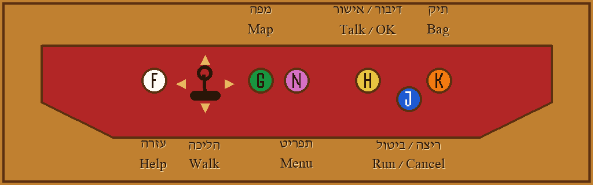

# Desert Town controls

The game is played two ways. On a dev machine the keys below are the keyboard.
On the arcade cabinet, each physical button is wired to one of these keys (the
board acts like a keyboard). GPIO wiring is not part of this game code. The
color-to-key table lives in `game-files/Plugins/DesertTownArcade/000_controls.rb`
(`DesertTownControls::COLORS`).

## The panel



```
 (White F)  [joy=arrows]  (Green G)(Pink N)     (Yellow H)          (Orange K)
                                                          (Blue J)
```

The panel has 6 buttons and a joystick. There is no Red button; the panel
surface itself is red. The empty hole at the lower right is not a button.
Regenerate the picture with `render_help_slide.py` (see Slides).

## On the cabinet: USB encoder and translator

The cabinet panel is wired to a USB joystick encoder ("DragonRise Inc. Generic
USB Joystick"), not a keyboard board. While the game runs, the Pi's
`rpi_stuff/joy2keys/joy2keys.py` grabs the encoder and types the keys below on
a virtual keyboard. The port script starts and stops it
(`rpi_stuff/INSTALLATION_LOG.md`, Stage 10). The game code is unchanged.

| Color | js button | Key |
| --- | --- | --- |
| Yellow | 1 | H |
| Blue | 0 | J |
| Orange | 4 | K |
| White | 11 | F |
| Green | 3 | G |
| Pink | 2 | N |

The stick is mounted rotated. Axis 1 low is Up and high is Down. Axis 0 low is Right and high is Left. To rewire a button, change the table at the top of `joy2keys.py`.

## Color buttons

| Color | Key | What it does |
| --- | --- | --- |
| Yellow | H | Talk, confirm, and every other place C works. Same input as C (`Input::USE`). In mini-games: serve, approve, shoot, push, stamp, type. |
| Blue | J | Run while walking, and cancel, the same way X does. Same input as X (`Input::BACK`). Hold to run. Running shoes and the run style option still apply. |
| Orange | K | Opens the Bag. Press again while the Bag is open to close it. |
| White | F | Help slide, which draws this panel. Any button closes it. Music keeps playing. |
| Green | G | World map slide. Any button closes it. Music keeps playing. |
| Pink | N | Opens the pause menu (party, Pokedex, save, options). Same input as Z (`Input::ACTION`). |

Yellow, Blue and Pink are extra keys on the existing inputs. They do not replace C, X or Z.

## Unchanged keys

| Key | What it does |
| --- | --- |
| C, Enter, Space | Talk / confirm (`Input::USE`) |
| X, Esc | Run (hold) and cancel (`Input::BACK`) |
| Z, Shift | Pause menu (`Input::ACTION`) |
| B | Opens the Bag. This is the older arcade key. It does not close the Bag. Orange (K) is the toggle. |
| Arrows | Walk |
| A | Page up (`Input::JUMPUP`) |
| S | Page down (`Input::JUMPDOWN`) |
| D | Ready menu (`Input::SPECIAL`) |
| Q, W | Unused Essentials inputs (`Input::AUX1`, `Input::AUX2`) |

## Why not A, S, D, F, G as first proposed

The first proposal (before the final panel, when Red was still a button) was Red A, Blue S, Orange D, White F, Green G.

F and G are not used by the input system, so White and Green kept them.

A, S, and D are the default RGSS1 bindings (mkxp `keybindings.cpp`, confirmed against `Input` and the in-game controls help):

| Proposed | Already does |
| --- | --- |
| A | Jump Up: page up in lists, and the map-connection editor |
| S | Jump Down: page down in lists, and the map-connection editor |
| D | Special: opens the Ready menu |

Those three colors moved to the next free letters, H, J, and K. Pink took N, which is also free. Also left alone: C, X, Z, Q, W, B, and the animation-editor keys E, L, R, and P.

## Slides

Help text is `game-files/Plugins/DesertTownArcade/help_slide.txt`. Rebuild the picture with:

```bash
python3 game-files/Plugins/DesertTownArcade/render_help_slide.py
```

That writes `game-files/Graphics/Pictures/DesertTownHelp.png`. The game shows the PNG. It does not draw the Hebrew itself.

The world map picture is rebuilt from `maps/world_layout.json` and each outside map's `base.png`:

```bash
python3 game-files/Plugins/DesertTownArcade/render_world_map_slide.py
```

That writes `game-files/Graphics/Pictures/DesertTownWorldMap.png`. The stock Town Map graphics (`mapRegion0.png`, `mapRegion1.png`) are the Essentials regions Essen and Tiall, not Desert Town. PR #10's `mapRegion2.png` is not on main.

While either slide is up, any keyboard button closes it (arrows, C, X, Z, A, S, D, the color keys including N, Enter, Esc, Space). The slide code does not call `Audio`, `pbBGMPlay`, `pbBGMStop`, or `pbBGMFade`.

## Cabinet wiring later

The panel has 6 buttons and a 4-way joystick: 10 inputs. Map each one to one key:

| Button | Send this key |
| --- | --- |
| Yellow | H |
| Blue | J |
| Orange | K |
| White | F |
| Green | G |
| Pink | N |

| Joystick | Send this key |
| --- | --- |
| Up | Up arrow |
| Down | Down arrow |
| Left | Left arrow |
| Right | Right arrow |

The old extra C, X and Z cabinet buttons are dropped: Yellow, Blue and Pink replace them.
The wiring board must act as a keyboard (a USB encoder in keyboard mode or a GPIO keyboard driver).
A board that shows up as a gamepad cannot send the raw F, G, K and N keys.
